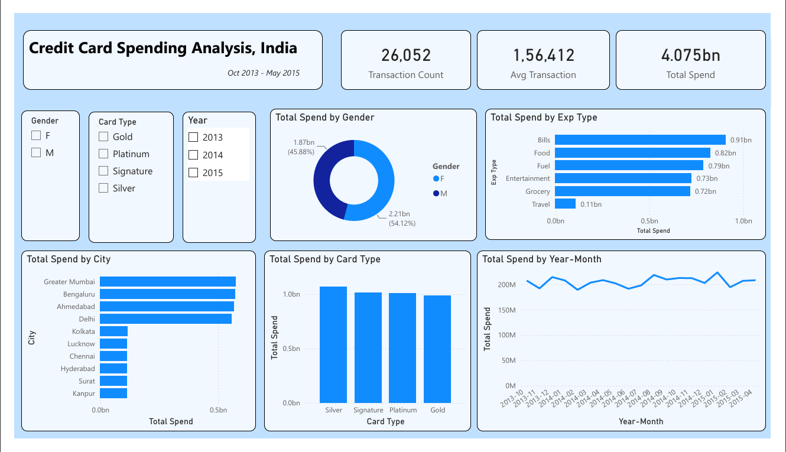
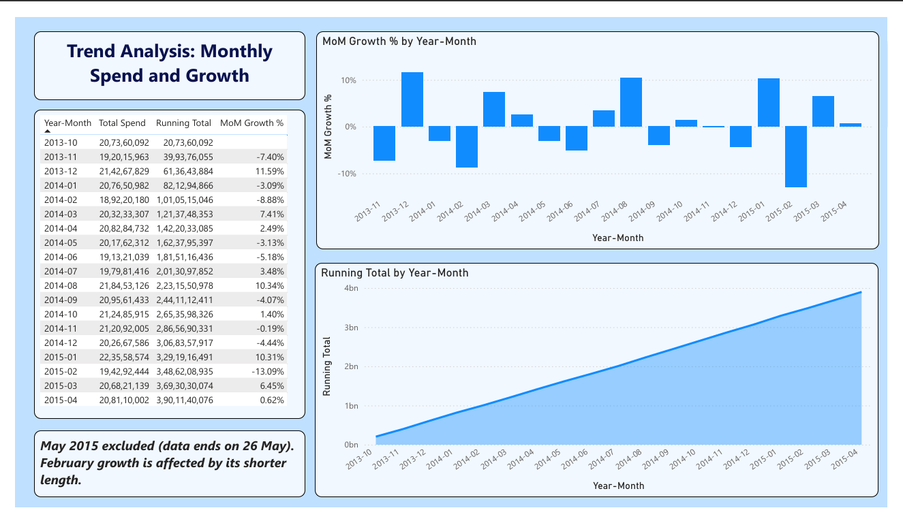

# Credit Card Spending Dashboard (Power BI)

An interactive Power BI dashboard analysing 26,052 credit card transactions across Indian cities, from October 2013 to 26 May 2015.

## Dashboard

## Data
- Source: Kaggle, "Analyzing Credit Card Spending Habits in India" (file: Credit card transactions - India - Simple.csv)
- 26,052 rows with City, Date, Card Type, Expense Type, Gender and Amount.
- The currency is not confirmed, so amounts are reported without a currency symbol.

## What I did
- **Power Query:** promoted headers, removed the index column, set data types, and removed ", India" from city names.
- **Data model:** a Transactions fact table linked to a DateTable (many-to-one, single direction), marked as the date table.
- **DAX measures:** Total Spend, Transaction Count, Avg Transaction, Spend Previous Month, MoM Growth %, Running Total, City Share %.
- **Report pages:** an Overview page with slicers (Gender, Card Type, Year) and a Trend Analysis page.

## Key findings
- Four cities (Greater Mumbai, Bengaluru, Ahmedabad, Delhi) account for 55.8% of total spend; every other city is far smaller.
- Bills is the largest expense type (22.3% of spend) and has the highest average transaction. Travel is the smallest (2.7%).
- Women account for 54.1% of spend and men for 45.9%.
- Spend is flat: monthly totals stay between roughly 189M and 224M, with no growth trend (the running total rises in a near-straight line).
- All four card tiers have similar total spend, close to 1bn each.

## Data caveats
- October 2013 starts on the 4th and May 2015 ends on the 26th. May 2015 is a partial month, so it is excluded from the trend charts and the MoM table.
- February month-over-month changes are affected by its shorter length.
- Spend is very evenly spread across cities and card tiers, and the file is labelled "Simple", so the patterns describe this dataset and not the real credit card market.
- The currency is unconfirmed.

## How to open
Download `credit-card-dashboard.pbix` and open it in Power BI Desktop. The data is stored inside the file. To refresh from the source, point the Power Query source to your own copy of the CSV.